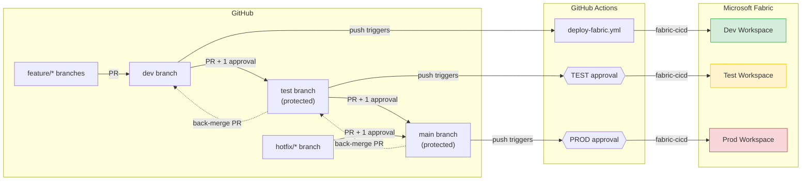

# GitHub Demo — Fabric CI/CD with Git-Based Deployments

Step-by-step guide to demo the full CI/CD flow using **GitHub** as the repository host and **GitHub Actions** as the pipeline engine.

> **Time estimate:** ~30 min for first-time setup, ~10 min for repeat demos.

---

## Architecture



**How it flows:** developers work on `feature/*` branches and merge into `dev` through a pull request, which deploys to the Dev workspace automatically. Promotion to Test and Prod happens through pull requests that need at least one approval, and each deployment then waits for an environment approver before it runs. Production fixes use a short-lived `hotfix/*` branch that is merged back down afterwards.

---

## Prerequisites

| # | Requirement | Details |
|---|---|---|
| 1 | **GitHub account** | With a fork of this repo (for a customer setup, use a private repository in the customer's GitHub organisation) |
| 1 | **Microsoft Fabric** | 3 workspaces: Dev, Test, Prod (Trial, Premium, or Fabric capacity) |
| 2 | **Azure Entra ID App Registration** | Service Principal with Fabric API permissions |
| 3 | **Fabric workspace access** | The Service Principal must be added as a **Member** or **Admin** in each workspace |
| 4 | **Fabric tenant setting** | **"Service principals can use Fabric APIs"** enabled by the Fabric admin (for the service principal or a security group that contains it) |
| 5 | **Connection access** (external data only) | The Service Principal must be a user on every Test/Prod data connection  |
| 6 | **GitHub plan** | Environment required reviewers on a **private** repository need a paid GitHub plan (Team or Enterprise); they are available on public repositories at no cost |

---

## Step 1 — Fork the Repository

1. Go to https://github.com/vanchaudhary/PowerBIReportCICD.
2. Click **Fork** → select your account → **Create fork**.
3. Clone your fork locally:

   ```bash
   git clone <URL>
   cd PowerBIReportCICD
   ```

---

## Step 2 — Create the Branch Structure

Create `dev` and `test` branches from `main`:

```bash
git checkout -b dev
git push -u origin dev

git checkout -b test
git push -u origin test

git checkout main
```

You now have three long-lived branches: `dev`, `test`, `main`. Day-to-day work never happens directly on them; see **Branching strategy** below.

### Step 2b — Protect the `test` and `main` branches

`main` deploys to **Prod** and `test` deploys to **Test**, so both are protected with a branch ruleset. Nobody, including admins, should be able to push to them directly or rewrite their history.

1. Go to your repository → **Settings** → **Rules** → **Rulesets** → **New ruleset** → **New branch ruleset**.
2. Ruleset name: `protect-test-and-main`.
3. Enforcement status: **Active**.
4. **Target branches** → **Add target** → **Include by pattern** → add `main` and `test`.
5. Enable these rules:

   | Rule | Setting | Why |
   |---|---|---|
   | **Restrict deletions** | On | The branch cannot be deleted |
   | **Block force pushes** | On | History cannot be rewritten with `git push --force` |
   | **Require a pull request before merging** | On, **Required approvals: 1** | Every change is reviewed by at least one other person |
   | Dismiss stale pull request approvals when new commits are pushed | On (recommended) | A re-pushed PR needs a fresh review |
   | Require conversation resolution before merging | On (recommended) | Review comments must be closed |

6. **Bypass list:** leave empty (or add only a break-glass admin role).
7. Click **Create**.

Optionally add a lighter ruleset for `dev` (block force pushes, require a pull request with 0 approvals) so feature work always arrives through a PR.

> **Tip:** With these rules in place, a direct push to `main` or `test` is rejected with error **GH013**. That is expected: open a pull request instead.

---

## Step 3 — Create the Azure Entra ID App Registration

1. Go to the [Azure Portal](https://portal.azure.com) → **Microsoft Entra ID** → **App registrations** → **New registration**.
2. Name: `Fabric CI/CD`.
3. Supported account type: **Single tenant**.
4. Click **Register**.
5. Note the **Application (client) ID** and **Directory (tenant) ID**.
6. Go to **Certificates & secrets** → **New client secret** → copy the **Value** (shown only once; do not copy the Secret ID).

> **Note:** Fabric REST APIs authorize via **workspace role**, not Microsoft Graph permissions. The actual access is granted in Step 3b below. The Fabric tenant admin must also enable **"Service principals can use Fabric APIs"** in the Fabric Admin portal.

### Step 3b — Add the Service Principal to Fabric Workspaces

For **each** workspace (Dev, Test, Prod):

1. Open the workspace in [app.fabric.microsoft.com](https://app.fabric.microsoft.com).
2. Click **Manage access** → **Add people or groups**.
3. Search for your App Registration name (`Fabric CI/CD`).
4. Assign the **Member** role.
5. Click **Add**.

---

## Step 4 — Configure GitHub Environments and Secrets

### 4a. Create three GitHub Environments

1. Go to your fork → **Settings** → **Environments** → **New environment**.
2. Create three environments named exactly: `DEV`, `TEST`, `PROD`.

### 4b. Add secrets to each environment

The workflow resolves the environment from the branch name (`dev` → `DEV`, `test` → `TEST`, `main` → `PROD`) and only loads the secrets for that environment.

**All three environments (`DEV`, `TEST`, `PROD`) need:**

| Secret Name | Value |
|---|---|
| `AZURE_CLIENT_ID` | App Registration client ID |
| `AZURE_CLIENT_SECRET` | App Registration client secret |
| `AZURE_TENANT_ID` | Entra ID tenant ID |
| `FABRIC_WORKSPACE_ID` | The target Fabric workspace GUID **for that environment** |

These four secrets are sufficient for this demo. All tables use embedded sample
data, so no external database, gateway, or connection-ID secrets are required.

Creating an environment does not share its secrets with other environments.
The `UAT` environment belongs to the separate deployment-pipeline workflow; this
workflow maps only `dev`, `test`, and `main` to `DEV`, `TEST`, and `PROD`.

> **Finding your workspace ID:** Open the workspace in Fabric — the URL contains the GUID:
> `https://app.fabric.microsoft.com/groups/<workspace-id>/...`

> **Note:** An environment secret overrides a repository secret with the same name. If you rotate the client secret, update it in every place it is stored.

### 4c. Add approval gates to `TEST` and `PROD`

Branch rulesets (Step 2b) control **what is merged**. Environment protection rules control **when a deployment runs**. Use both.

For the **`TEST`** and **`PROD`** environments:

1. Go to **Settings** → **Environments** → select the environment.
2. Tick **Required reviewers** and add the approvers (people or a team; up to 6). For `PROD`, use the release owner or a small release team.
3. (Recommended) Tick **Prevent self-review**, so the person who triggered the run cannot approve it.
4. Under **Deployment branches and tags**, choose **Selected branches and tags** and add:
   - `TEST` → `test` only
   - `PROD` → `main` only
5. Click **Save protection rules**.

Leave `DEV` without reviewers so that merges into `dev` deploy immediately.

When a run reaches a protected environment, it pauses with the status **Waiting**. An approver opens the run in the **Actions** tab → **Review deployments** → selects the environment → **Approve and deploy** (or **Reject**).

---

## Step 5 — Keep the sample parameter configuration

The repo ships [parameter.yml](../parameter.yml) with no active overrides:

```yaml
find_replace: []
```

Keep this configuration for the embedded-data demo. The workflow deploys the
same report and sample data to each environment's target workspace without
replacing connection IDs. GitHub source-control connections are not semantic
model data connections and are not needed as parameter overrides.

If you later switch to an external data source, follow Step 6.

---

## Step 6 — External data sources: connection IDs and service principal access

*Skip this step for the embedded-data demo. Use it when the semantic model reads from SQL, a lakehouse, SharePoint or another external source.*

### 6a. Give the service principal access to each connection

`fabric-cicd` can swap a semantic model's connection ID during deployment, but the swap fails unless the service principal is allowed to use the target connection.

For **each** Test and Prod connection (and Dev if it is deployed by the workflow):

1. In Fabric, select **Settings** (gear icon) → **Manage connections and gateways**.
2. Open the **Connections** tab and select the connection.
3. Select **Manage users** (the **⋯** menu next to the connection, or the ribbon).
4. Search for the App Registration name (`Fabric CI/CD`), or a security group that contains it.
5. Assign **User** (enough to bind a model to the connection). Use **Owner** only if the pipeline must also edit the connection.
6. Click **Share**.

> **Finding a connection ID:** On the same page, open the connection's **Settings** → copy the **Connection ID**.

### 6b. Add the connection IDs to GitHub and `parameter.yml`

1. Add a secret to the matching environment only:

   | Environment | Secret | Value |
   |---|---|---|
   | `TEST` | `TEST_CONNECTION_ID` | Connection GUID used by the semantic model in the **Test** workspace |
   | `PROD` | `PROD_CONNECTION_ID` | Connection GUID used by the semantic model in the **Prod** workspace |

2. Replace the empty list in `parameter.yml` with the **Dev** connection GUID and tokens for Test and Prod:

   ```yaml
   find_replace:
       - find_value: "<your-dev-connection-guid>"   # connection ID used by the DEV semantic model
         replace_value:
             TEST: "__TEST_CONNECTION_ID__"          # replaced by the workflow at runtime
             PROD: "__PROD_CONNECTION_ID__"          # replaced by the workflow at runtime
         item_type: "SemanticModel"
   ```

3. Make sure the workflow replaces the tokens with the secrets before `fabric-cicd` runs. Only ever commit the **Dev** GUID.

---

## Step 7 — Post-deployment: data source credentials and first refresh

A deployment publishes the **definition** of the semantic model, not its data. After the first deployment to each workspace, the model must be refreshed (and, for external sources, given credentials) before the report shows data.

### Option A — One-time manual step per environment (simplest)

Do this once in each of the Dev, Test and Prod workspaces, after the first successful deployment:

1. Open the workspace → the semantic model → **⋯** → **Settings**.
2. Expand **Gateway and cloud connections** (or **Data source credentials**) and map the model to the correct connection, or select **Edit credentials** and sign in. Embedded sample data needs no credentials.
3. Expand **Refresh** and, if needed, configure a **scheduled refresh**.
4. Select **Refresh now** and confirm the report shows data.

Later deployments of the same model keep these settings, so the step does not need to be repeated unless the model is deleted and recreated.

### Option B — Automated refresh after each deployment

Add this step to `deploy-fabric.yml` after the `fabric-cicd` deployment step. It requests a token for the service principal, finds the semantic model by name in the target workspace and starts a refresh.

```yaml
      - name: Refresh semantic model
        if: success()
        env:
          AZURE_CLIENT_ID: ${{ secrets.AZURE_CLIENT_ID }}
          AZURE_CLIENT_SECRET: ${{ secrets.AZURE_CLIENT_SECRET }}
          AZURE_TENANT_ID: ${{ secrets.AZURE_TENANT_ID }}
          FABRIC_WORKSPACE_ID: ${{ secrets.FABRIC_WORKSPACE_ID }}
          SEMANTIC_MODEL_NAME: "My new report"
        run: |
          TOKEN=$(curl -s -X POST \
            "https://login.microsoftonline.com/$AZURE_TENANT_ID/oauth2/v2.0/token" \
            -d "grant_type=client_credentials" \
            -d "client_id=$AZURE_CLIENT_ID" \
            --data-urlencode "client_secret=$AZURE_CLIENT_SECRET" \
            -d "scope=https://analysis.windows.net/powerbi/api/.default" | jq -r .access_token)

          DATASET_ID=$(curl -s -H "Authorization: Bearer $TOKEN" \
            "https://api.powerbi.com/v1.0/myorg/groups/$FABRIC_WORKSPACE_ID/datasets" \
            | jq -r --arg n "$SEMANTIC_MODEL_NAME" '.value[] | select(.name==$n) | .id')

          if [ -z "$DATASET_ID" ]; then
            echo "Semantic model '$SEMANTIC_MODEL_NAME' not found"; exit 1
          fi

          curl -s -f -X POST \
            -H "Authorization: Bearer $TOKEN" \
            -H "Content-Type: application/json" \
            "https://api.powerbi.com/v1.0/myorg/groups/$FABRIC_WORKSPACE_ID/datasets/$DATASET_ID/refreshes" \
            -d '{"notifyOption":"NoNotification"}'

          echo "Refresh requested for $SEMANTIC_MODEL_NAME ($DATASET_ID)"
```

Notes:

- The refresh call returns as soon as the refresh is **queued**. To fail the run when a refresh fails, poll `GET .../datasets/{id}/refreshes?$top=1` until the status is `Completed` or `Failed`.
- The service principal can refresh the model because it deployed it and is its owner. If someone else took over the model, take it back with **Settings** → **Take over**, or call the `Default.TakeOver` API as the service principal.
- For external sources, the credentials or connection mapping from Option A (or Step 6a) must exist first; the API cannot refresh a model that has no valid credentials.

---

## Branching strategy

### Feature branches → `dev`

Nobody commits directly to `dev`, `test` or `main`. Each piece of work gets its own short-lived branch:

```bash
git checkout dev
git pull
git checkout -b feature/sales-ytd-measure
# make changes in Power BI Desktop, save, then:
git add .
git commit -m "Add Sales YTD measure"
git push -u origin feature/sales-ytd-measure
```

1. Open a pull request from `feature/sales-ytd-measure` → `dev`.
2. Review and merge. The merge is a push to `dev`, so the workflow deploys to the **Dev** workspace automatically.
3. Delete the feature branch after the merge.

Close Power BI Desktop before you pull, switch branches or resolve a merge, and reopen the `.pbip` afterwards.

### Promotion is all-or-nothing

A pull request from `dev` → `test` carries **everything** currently in `dev`, including work that is not finished. Plan for it:

- **Merge only finished, reviewed features into `dev`.** Treat `dev` as "ready to test", not as a scratch area. Unfinished work stays on its feature branch.
- **Promote in batches.** Agree which features go in a release, merge those into `dev`, then promote `dev` → `test` → `main` together.
- **If something in `dev` must not go forward,** revert its merge commit on `dev` (`git revert -m 1 <merge-commit>` via a PR) before promoting, and re-apply it later.
- **Alternative model:** use one `main` branch with staged environments (a single workflow that deploys to DEV automatically, then waits for TEST approval, then PROD approval). Every change is promoted individually and there is no branch-to-branch merging. Consider it if partial promotion becomes a regular problem.

### Hotfix path

A fix that goes straight to Prod must also flow back to `test` and `dev`, otherwise the next normal promotion overwrites it.

1. Branch from `main`:

   ```bash
   git checkout main
   git pull
   git checkout -b hotfix/fix-sales-total
   # fix, save, commit
   git push -u origin hotfix/fix-sales-total
   ```

2. Open a PR from `hotfix/fix-sales-total` → `main`. It needs 1 approval (ruleset), then the PROD deployment needs environment approval.
3. After Prod is verified, **back-merge** with pull requests: `main` → `test`, then `test` → `dev`. (Direct pushes are blocked by the rulesets, so these must be PRs.)
4. The `main` → `test` merge also redeploys Test (with approval); that is expected and keeps Test in line with Prod.
5. Delete the hotfix branch.

---

## Demo Walkthrough

### Demo 1 — Deploy to Dev

1. Create a feature branch from `dev` and make a change (e.g., edit a measure in [`My new report.SemanticModel/definition/tables/Sales.tmdl`](../My%20new%20report.SemanticModel/definition/tables/Sales.tmdl)):

   ```bash
   git checkout dev
   git pull
   git checkout -b feature/new-sales-measure
   # make your change
   git add .
   git commit -m "Add new measure to Sales"
   git push -u origin feature/new-sales-measure
   ```

2. Open a PR from `feature/new-sales-measure` → `dev` and merge it.
3. Open the **Actions** tab in GitHub — the `Deploy to Fabric Workspace` run starts automatically.
4. The workflow targets the `DEV` environment and deploys via `fabric-cicd` with `environment=DEV`.
5. Open the **Dev** workspace in Fabric and verify the change (refresh the model first if this is its first deployment; see Step 7).

### Demo 2 — Promote to Test

1. In GitHub, open a PR from `dev` → `test`.
2. A reviewer approves the PR (the ruleset needs 1 approval), then **merge** it (this pushes to `test`).
3. The push triggers the workflow on the `test` branch with the `TEST` environment. The run shows **Waiting**.
4. An approver selects **Review deployments** → **TEST** → **Approve and deploy**.
5. The workflow deploys the report and embedded-data semantic model to the **Test** workspace.
6. Open the **Test** workspace and verify the change.

### Demo 3 — Promote to Prod

1. Open a PR from `test` → `main`.
2. Get 1 approval and merge.
3. The workflow waits for the **PROD** approval; approve it.
4. The workflow runs against the `PROD` environment and deploys to the **Prod** workspace.

### Demo 4 (optional) — Hotfix

1. Branch `hotfix/...` from `main`, make a small fix, PR to `main`, approve and deploy to Prod.
2. Back-merge `main` → `test` → `dev` with pull requests and show that all three branches now contain the fix.

### Key talking points

> "The report and embedded sample data stay the same across environments. The branch selects the GitHub Environment, which supplies the target workspace ID and deployment credentials."

> "Two controls protect production: the branch ruleset means nothing reaches `main` without a reviewed pull request, and the environment approval means nothing deploys to Prod without a named approver saying go."

---

## Troubleshooting

| Problem | Solution |
|---|---|
| Workflow not triggering | Confirm the workflow file exists on the target branch and that the branch is `dev`, `test`, or `main`. Merges into feature branches do not deploy. |
| `ModuleNotFoundError: fabric_cicd` | Ensure `requirements.txt` is present and lists `fabric-cicd`. |
| Authentication failure | Verify the SPN has **Member** access to the target workspace and that all `AZURE_*` and `FABRIC_WORKSPACE_ID` secrets are set in the **correct** GitHub Environment. Make sure the secret holds the client secret **Value**, not its ID. |
| `Invalid workspace_id` | The `FABRIC_WORKSPACE_ID` secret must contain only the GUID (no URL prefix). |
| Workflow still asks for connection-ID secrets or reports missing replacement values | Ensure the target branch has the current workflow and `parameter.yml` with `find_replace: []`. Push a new commit to start a new run; rerunning an old run uses its old workflow. |
| Push to `main` or `test` rejected with **GH013** | Expected: the branch ruleset blocks direct pushes. Push to a feature or hotfix branch and open a pull request. |
| `git push --force` rejected | Expected: force pushes are blocked on protected branches. |
| PR cannot be merged ("Review required") | At least 1 approval from someone other than the author is needed. |
| Run stuck on **Waiting** | The environment needs approval: **Actions** → the run → **Review deployments**. |
| Deployment rejected: branch not allowed | The environment's **Deployment branches** list doesn't include this branch (`TEST` only allows `test`, `PROD` only allows `main`). |
| Connection swap fails / "connection not found" or access denied on a connection | The service principal isn't a user on that connection: add it under **Manage connections and gateways** → connection → **Manage users** (Step 6a). Check the connection GUID in the secret. |
| Tokens (`__TEST_CONNECTION_ID__`) appear in the deployed model | The matching `TEST_CONNECTION_ID` / `PROD_CONNECTION_ID` secret is missing from the resolved environment. |
| Report shows no data after deployment | The model hasn't been refreshed yet, or has no credentials. Run Step 7. |
| Refresh API returns 401/403 | The service principal is not the model owner or lacks workspace access. Take over the model as the service principal, or check its workspace role. |
| Refresh fails with a credentials error | Set credentials or map the model to a connection in the workspace (Step 7, Option A). |
| A Prod hotfix disappeared after the next release | It wasn't back-merged. Merge `main` → `test` → `dev` (Branching strategy → Hotfix path). |

---

## File Reference

| File | Purpose |
|---|---|
| [.github/workflows/deploy-fabric.yml](../.github/workflows/deploy-fabric.yml) | GitHub Actions workflow — triggers on push to `dev`/`test`/`main`; optional refresh step (Step 7) |
| [.deploy/fabric_workspace.py](../.deploy/fabric_workspace.py) | Python deployment script using `fabric-cicd` |
| [parameter.yml](../parameter.yml) | Empty override list for the embedded-data demo; connection-ID overrides for external data (Step 6) |
| [requirements.txt](../requirements.txt) | Python dependencies |

## GitHub settings reference

| Setting | Where | Value |
|---|---|---|
| Branch ruleset `protect-test-and-main` | Settings → Rules → Rulesets | Targets `main`, `test`; restrict deletions, block force pushes, require PR with 1 approval |
| Environment `DEV` | Settings → Environments | Secrets only; no reviewers |
| Environment `TEST` | Settings → Environments | Required reviewers; deployment branch `test` |
| Environment `PROD` | Settings → Environments | Required reviewers; prevent self-review; deployment branch `main` |
